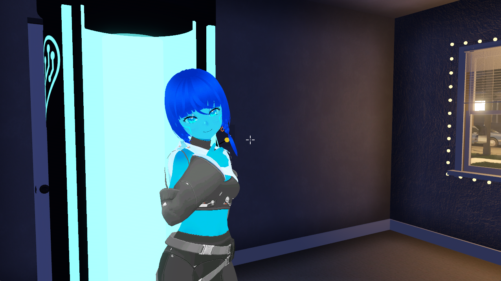
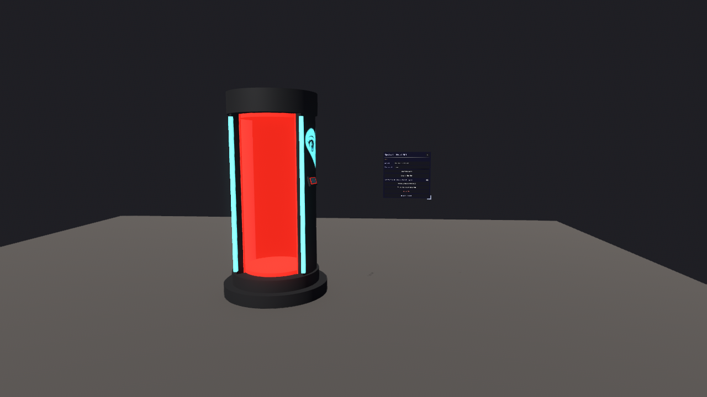

# Synthetic Heart Rift (`xenu.synth_rift`)

A mod for [RetroXR](https://github.com/RetroXR/RetroXR): the **Rift Summoner**, an object that brings Synthetic Heart
into the room. Switch it on and Synthetic Heart steps out of a pod. They walk, turn, talk, look at things and carry
them, sit, watch the TV and listen through the chat page's microphone. They never play a game: a verb that is not on
the protocol's list is refused, and nothing is written to a core.

It needs a **Synthetic Heart server** (the Rift Vessel socket, `/api/vessel/retroxr/ws`).

## Screenshots

## Install

Get `xenu.synth_rift-<version>.zip` from the [releases](../../releases) and put it in your RetroXR data folder,
under `mods/` (`~/retroxr/mods/` on desktop). Then enable it in the MODS tab.

## Build the pack

    python3 tools/pack_mod.py            # writes dist/xenu.synth_rift-<version>.zip and reads it back

The pack holds source files only. The body's model and animations come from the Synthetic Heart server's skin,
never from this repository.

## Releases

A push to `main` publishes a release when it brings a `feat`, `fix` or `perf` commit since the previous one. The version
is computed from the commits, not written by hand: `feat` raises the minor, `fix`/`perf` the patch, a breaking change
(`!` or a `BREAKING CHANGE:` footer) the major (the minor while it is 0). `chore`, `docs`, `ci` and the like release
nothing. The version of `mod.json` only matters for a first release; the pack carries the computed one. The notes are
the commits since the previous release: `feat` under Changes, `fix` under Fixes. The same zip, version and notes are then added to the mod on
[mod.io](https://mod.io/g/retroxr/) by [`tools/publish_modio.py`](tools/publish_modio.py), using the secret
`MODIO_PAT` and the variable `MODIO_MOD_SLUG` (the mod's address on mod.io); its visibility is never changed, and a
failure there is a warning, not a failed release. See [`.github/workflows/release.yml`](.github/workflows/release.yml).

## Layout

[`README.txt`](README.txt) has the file-by-file map and the test commands. In short:

- `mod_main.gd` the entry point; `mod.json` the manifest
- `scripts/` the protocol, the socket, the body, the pod, the menu and the tests' targets
- `scenes/` the pod, its menu and the chat page
- `tests/` probes and unit tests, run against a RetroXR checkout
- `tools/` the pack and release scripts, which are not part of the mod
